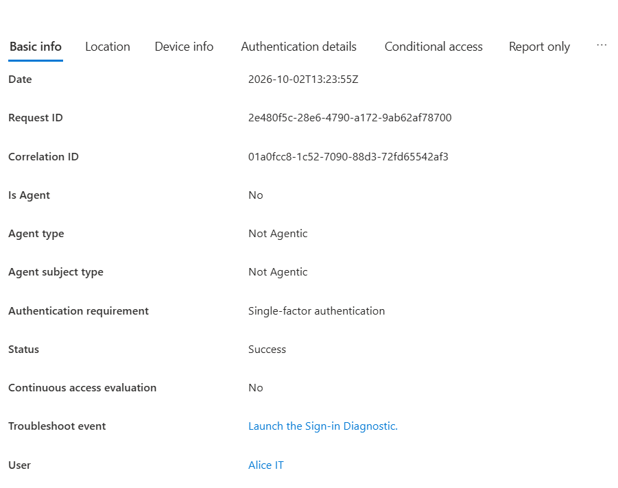

# ATLAS Cloud Identity Security Lab

**Microsoft Entra ID Free · Identity and access management · Sign-in analysis · User offboarding**

A hands-on identity administration lab for a small organization with IT, HR, and Finance departments. The project documents user and group administration, a separate administrative identity, analysis of a successful sign-in, and an employee offboarding exercise.

The repository presents the lab's recorded results and their evidence. It is a portfolio case study, not a production security baseline or an automated deployment.

## Lab at a glance

| Component | Recorded configuration |
| --- | --- |
| Tenant | ATLAS Cloud Lab |
| License | Microsoft Entra ID Free |
| Users | 5 identities: three department test users, a dedicated administrator, and the tenant owner |
| Groups | 3: GRP-IT, GRP-HR, and GRP-FINANCE |
| Dedicated administrator | ATLAS Cloud Admin, assigned Global Administrator according to the lab record |
| Sign-in evidence | Alice IT: Success; Single-factor authentication; 2 October 2026 |
| Offboarding evidence | Sara HR: account disabled; session revocation recorded on 2 October 2026 |
| Management interface | Microsoft Azure portal |

Counts describe the captured lab state, not a live tenant inventory. Department users are test identities; the user list also contains the tenant owner's account.

## What the project demonstrates

- **Identity administration:** organizing cloud identities and three departmental security groups.
- **Administrative separation:** maintaining a dedicated ATLAS Cloud Admin account. The Global Administrator assignment demonstrates role administration, not least-privilege hardening.
- **Sign-in analysis:** reading the result, timestamp, user, and authentication requirement of a recorded event.
- **Offboarding:** disabling Sara HR, recording session revocation, and removing group membership as confirmed by the lab owner.
- **Evidence-based reporting:** distinguishing visible results from owner-confirmed actions and unverified settings.

## Results and evidence

| Result | Evidence | Qualification |
| --- | --- | --- |
| Entra ID Free tenant with 5 users and 3 groups | [Tenant overview](screenshots/01-tenant-overview.png) | Snapshot of the lab |
| Department users and dedicated administrator exist | [User directory](screenshots/02-users.png) | Includes the tenant owner |
| Three departmental groups exist | [Group directory](screenshots/03-groups.png) | Individual membership is not visible |
| Global Administrator role assignment | [Role view](screenshots/04-admin-role.png) | The crop shows the role; attribution to ATLAS Cloud Admin is confirmed by the lab owner |
| Alice IT successfully signed in | [Sign-in details](screenshots/05-alice-signin-success.png) | Single-factor requirement; does not demonstrate completed MFA |
| Sara HR is disabled | [Offboarding state](screenshots/06-sara-offboarding.png) | Account enabled: No |
| Sara's sessions were revoked on 2 October 2026 | [Offboarding state](screenshots/06-sara-offboarding.png) | Owner-confirmed action; the image shows the sessions-valid-from timestamp, not an audit event |
| Sara's group membership was removed | [Offboarding record](docs/offboarding.md) | Owner-confirmed; no membership screenshot is available |

## Documentation

| Document | Contents |
| --- | --- |
| [Architecture](docs/architecture.md) | Environment, identity layout, administrative boundary, and scope |
| [Identity management](docs/identity-management.md) | Users, groups, role assignment, and evidence limits |
| [Security controls](docs/security-controls.md) | Recorded controls, unverified settings, and licensing boundaries |
| [Sign-in monitoring](docs/sign-in-monitoring.md) | Alice's event, interpretation, and review procedure |
| [Offboarding](docs/offboarding.md) | Sara's recorded actions, results, and validation limits |
| [Evidence review](docs/evidence-review.md) | Screenshot inventory, publication review, and remaining evidence gaps |

## Screenshot gallery

### Tenant overview

### User directory

### Department groups

### Administrative role

The original crop does not include the account heading.

### Alice's successful sign-in

### Sara's offboarding state

## Security scope and limitations

**MFA completion has not been demonstrated.** Alice's recorded event has a single-factor authentication requirement. The tenant's Security Defaults setting is **unverified**; the license and this event alone do not establish whether it is enabled or disabled.

Custom Conditional Access policies and paid Azure security services were not implemented as part of this lab. Group creation does not demonstrate application authorization. Session revocation does not, by itself, prove that every application session ended immediately.

The six published screenshots were visually reviewed on 10 October 2026. No visible passwords, access tokens, client secrets, private keys, or MFA recovery codes were found. The images retain account names, directory identifiers, and the tenant domain; they are not anonymized. See the [evidence review](docs/evidence-review.md) for the exact scope.

## Repository layout

~~~text
.
├── README.md
├── docs/
│   ├── architecture.md
│   ├── identity-management.md
│   ├── security-controls.md
│   ├── sign-in-monitoring.md
│   ├── offboarding.md
│   └── evidence-review.md
└── screenshots/
    ├── 01-tenant-overview.png
    ├── 02-users.png
    ├── 03-groups.png
    ├── 04-admin-role.png
    ├── 05-alice-signin-success.png
    └── 06-sara-offboarding.png
~~~

## Lessons learned and next steps

The exercise shows how identity inventory, role assignment, authentication evidence, and offboarding fit together. A successful login is not proof of MFA, and a configured control is not proof of its end-to-end effect.

Future validation can strengthen the case study by capturing the Security Defaults setting, a completed MFA event, the administrator's identity alongside its assigned role, Sara's final group membership, and a blocked sign-in after offboarding. These are future evidence improvements, not completed lab results.
