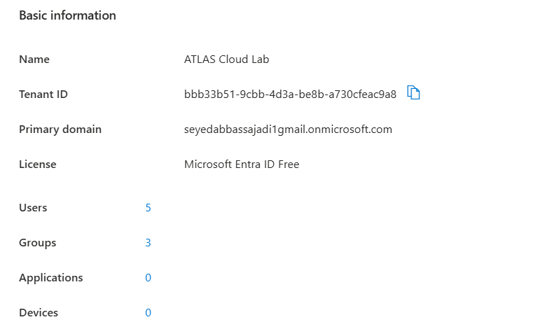

# Lab architecture

[Back to project overview](../README.md)

## Environment

ATLAS Cloud Lab models a small organization's cloud identities in Microsoft Entra ID. The published tenant overview records the following state.

| Component | Observed value |
| --- | --- |
| Tenant name | ATLAS Cloud Lab |
| License | Microsoft Entra ID Free |
| Users | 5 |
| Groups | 3 |
| Applications shown in overview | 0 |
| Devices shown in overview | 0 |
| Administration interface | Microsoft Azure portal |

These are screenshot values. They do not establish the current tenant state or the absence of every possible service principal or external integration.

## Identity layout

| Identity | Lab purpose | Department group in the lab design |
| --- | --- | --- |
| Alice IT | IT test identity and sign-in analysis | GRP-IT |
| Sara HR | HR test identity and offboarding exercise | GRP-HR before offboarding |
| Omar Finance | Finance test identity | GRP-FINANCE |
| ATLAS Cloud Admin | Dedicated privileged administration | Not established by the screenshots |
| Tenant owner | Initial tenant administration | Not established by the screenshots |

The user directory proves that the five identities exist in the captured state. The group directory proves that the three named groups exist. Their individual membership lists are not included in the published evidence.

~~~text
ATLAS Cloud Lab — Microsoft Entra ID Free
│
├── Administration
│   ├── Tenant owner
│   └── ATLAS Cloud Admin
│       └── Global Administrator (owner-confirmed account attribution)
│
├── Department test identities
│   ├── Alice IT       → intended department: GRP-IT
│   ├── Sara HR        → intended department: GRP-HR
│   └── Omar Finance   → intended department: GRP-FINANCE
│
└── Recorded exercises
    ├── Alice: successful sign-in, single-factor requirement
    └── Sara: disabled, sessions revoked, membership removal confirmed
~~~

The department arrows describe the lab design; they are not an independently verified membership export.

## Administrative boundary

A separate ATLAS Cloud Admin identity was used for privileged administration. The lab owner confirms its Global Administrator assignment. The role screenshot shows a direct, built-in Global Administrator assignment but crops out the account heading.

This demonstrates separation of administrative and department identities. It does not demonstrate least privilege, privileged identity management, time-limited elevation, or a review of every account's roles.

## Lifecycle and observation

The recorded workflow covers identity creation, departmental organization, sign-in review, and offboarding. Alice's event is the authentication evidence. Sara's disabled account and sessions-valid-from timestamp support the offboarding record.

No application access enforcement, hybrid directory synchronization, custom Conditional Access, or paid security integration is claimed. Security Defaults status and completed MFA remain unverified.

## Related documentation

- [Identity management](identity-management.md)
- [Security controls](security-controls.md)
- [Sign-in monitoring](sign-in-monitoring.md)
- [Offboarding](offboarding.md)
- [Evidence review](evidence-review.md)
