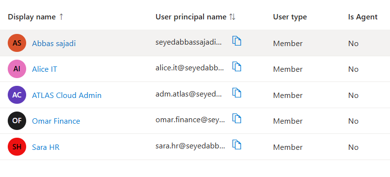
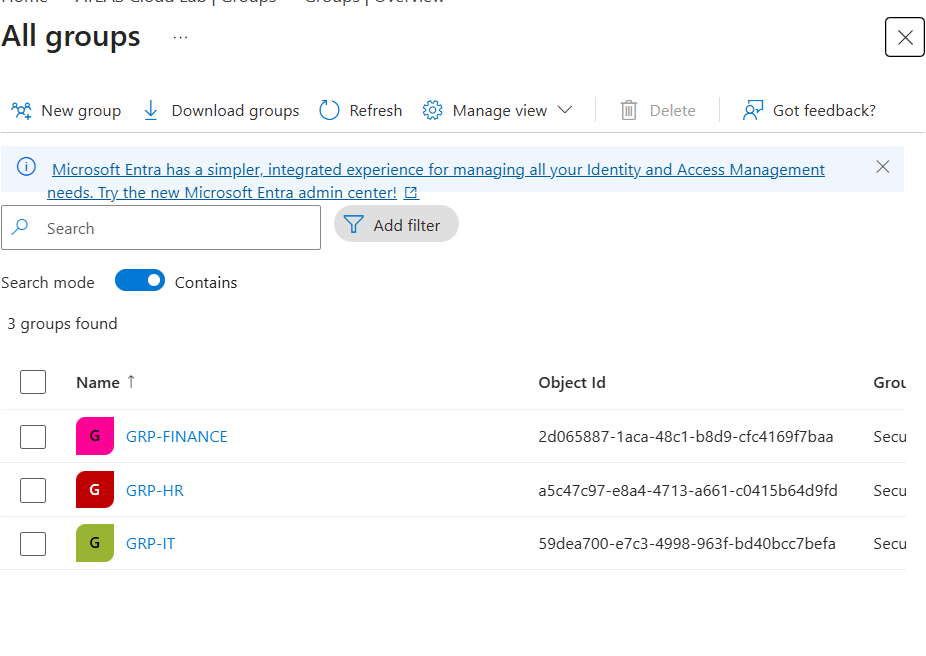
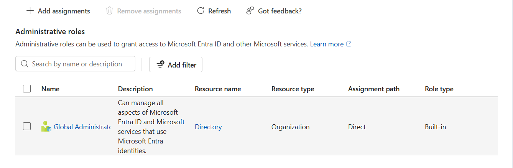

# Identity and access management

[Back to project overview](../README.md)

## User inventory

The lab directory contains five identities in the published screenshot.

| Account | Purpose |
| --- | --- |
| Alice IT | IT department test user |
| Sara HR | HR department test user and offboarding subject |
| Omar Finance | Finance department test user |
| ATLAS Cloud Admin | Dedicated administrative account |
| Tenant owner | Initial tenant administration |

The department accounts are test identities. The tenant owner's account is also visible, so the evidence is not described as containing only fictional identities.

## Department groups

| Group | Intended department | Intended initial test member |
| --- | --- | --- |
| GRP-IT | IT | Alice IT |
| GRP-HR | HR | Sara HR |
| GRP-FINANCE | Finance | Omar Finance |

The table records the lab's intended organization. The screenshot establishes group existence, not individual membership. The lab owner confirms that Sara's group membership was removed during offboarding; no before-and-after membership views are published.

This exercise demonstrates the basis for group administration. It does not establish that the groups were assigned access to an application or Azure resource.

## Administrative role

The lab owner confirms that ATLAS Cloud Admin was assigned Global Administrator. The user directory shows the separate account; the role image shows a direct assignment of the built-in role.

The role image does not include the account heading. An expanded capture would independently connect the role to the named administrator.

Administrative account separation reduces the need to use a department identity for privileged tasks. Global Administrator is a broad role, so its assignment is not evidence that least privilege was achieved.

## Workflow documented by the lab

1. Create the department test identities and dedicated administrator.
2. Create the three department groups.
3. Organize users according to the lab design.
4. Assign the dedicated administrative role.
5. Review Alice's sign-in event.
6. Offboard Sara by disabling the account, revoking sessions, and removing group membership.

The inventory images document resulting objects rather than the creation audit trail. No passwords or password-generation process are included.

## Lifecycle outcome

Sara remains a disabled identity in the recorded state. Disabling an account is distinct from deleting it. Session revocation is owner-confirmed and supported by the recorded sessions-valid-from timestamp; membership removal is owner-confirmed without a published membership screenshot.

See [offboarding](offboarding.md) for the action-by-action evidence and [security controls](security-controls.md) for the limits of the security claims.
