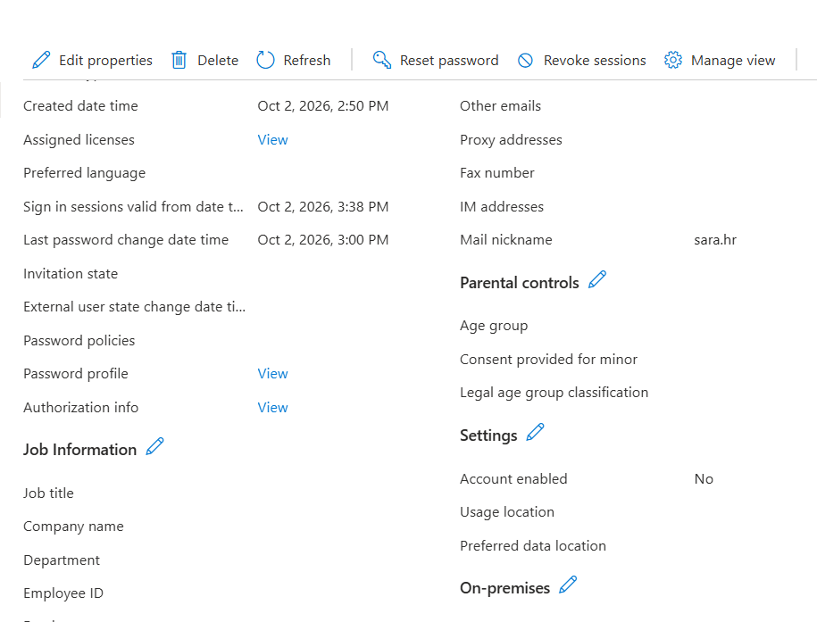

# Employee offboarding: Sara HR

[Back to project overview](../README.md)

## Scenario

Sara HR is the test identity used to simulate an employee leaving the organization. The lab owner confirms that the account was disabled, sessions were revoked on 2 October 2026, and group membership was removed.

The published evidence documents the resulting user properties, not a complete audit trail.

## Actions and evidence

| Action | Recorded result | Verification level |
| --- | --- | --- |
| Disable the account | Account enabled is No | Visible in the screenshot |
| Revoke sign-in sessions | Lab owner confirms revocation on 2 October 2026 | Supported by a sessions-valid-from timestamp; no audit event is published |
| Remove department group membership | Lab owner confirms removal from GRP-HR | No membership view or audit event is published |
| Retain the identity | Sara remains present as a disabled user | Visible in the user and properties screenshots |

The image shows the mail nickname sara.hr, **Account enabled: No**, and **Sign in sessions valid from** displayed as **Oct 2, 2026, 3:38 PM**. The screenshot does not show its timezone, so that displayed time is not converted to UTC.

A Revoke sessions button alone would not prove the action was performed. Here, the owner-confirmed action is supported by the timestamp; the properties view is still not an audit record of the click or its actor.

## Documented workflow

1. Select the Sara HR test identity and disable the account.
2. Remove its departmental group membership.
3. Revoke its sign-in sessions.
4. Review the disabled state and updated session validity information.
5. Retain the disabled identity to document the exercise.

The lab owner confirms completion of the first three actions. The screenshot supports the final state described above. It does not establish the exact order or timing of every action.

## Security interpretation

Account disabling and session revocation address different parts of access removal. Existing access tokens and application-managed sessions may continue until the relevant application or token handling takes effect. Microsoft's [access revocation guidance](https://learn.microsoft.com/en-us/entra/identity/users/users-revoke-access) explains these limits.

The available evidence does not demonstrate immediate termination of every session, application-specific deprovisioning, or a failed post-offboarding sign-in. No application integration is claimed by this lab.

## Follow-up validation

A more complete offboarding record would include:

- A final group membership view for Sara.
- An audit event for account disabling and session revocation.
- A new sign-in attempt that is blocked because the account is disabled.
- Application-side access checks if applications are later added to the lab.

These checks are not marked as completed. See the [evidence review](evidence-review.md) for the distinction between visible evidence and owner-confirmed actions.
